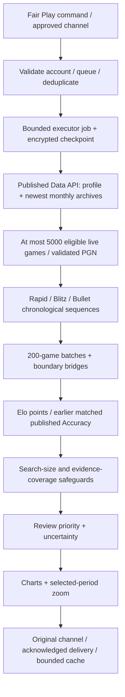

# Fair Play v68 — technical and scientific audit

Audit date: 22 October 2026 (Europe/Amsterdam). Baseline: `032c37521a4564ad379c457cf4456c00f600bffe`, detector `fairplay-v67-opening-rating-calibration`. Proposed detector: `fairplay-v68-evidence-integrity`. **Draft for review; no production restart, merge or deployment is part of this audit.**

## A. Executive assessment

Method 3 is a fast **results-anomaly triage system**, not a validated engine-assistance classifier. Its useful properties are explicit Elo-point expectations, chronological searches, separate rating pools, earlier-only Accuracy references, bounded collection, and a human-review boundary. The active workflow does not run Stockfish or Maia for this route. Reintroducing either model without validated incremental value would not fix the demonstrated defects.

The audit reproduced a genuine false-negative mechanism: twenty exceptional Rapid outcomes disappeared when normal Blitz games fragmented the global execution batches. It also reproduced false-positive mechanisms: omitted losing PGNs manufactured win sequences; missing opponent identities removed the repeated-opponent safeguard; and an empirical Accuracy percentile was treated as a known population percentile. These are algorithmic/data-integrity defects, independent of particular account labels.

The proposed changes repair these defects and improve private-channel recovery, cancellation, duplicate-delivery handling and evidence display. **They do not establish real-world precision, recall, false-positive rates, or a probability that any player cheated.** No named case was tuned to a requested label, and no closure/ban field enters analytical scoring.

## B. Architecture actually in use



- `fairplay_ui.py`: command validation, allowed staff/Taskforce channels, one heavy active job, queue, progress, cancellation, report/detail views and 30-minute successful-result reuse. `fairplay_routing.py` defines the allowed destinations. Queued jobs persist their destination through `fairplay_checkpoint.py`; this audit fixes its restoration.
- `fairplay_analysis.review`: selects Method 3 before the V51/deep/legacy routes when `FAIRPLAY_METHOD3=1`. The Daily workflow defaults that flag to 1. Setting V51 alone does not override Method 3. `fairplay_config.active_version` and the adapter expose the same version.
- `fairplay_method3.review`: 300-second cancellable collection/scoring deadline, 5,000-game live cap, rated and unrated combined, Bullet included, Daily/variants excluded. A valid PGN is parsed for eligibility and descriptive clocks. Full move parsing is **not** Stockfish analysis.
- `fairplay_data.PubAPI`: fixed official endpoints; redirects disabled; finite connect/read timeouts; bounded response bodies; sequential pacing; bounded retries/backoff; ETag-revalidated archive cache. Accounts/status are not serialized into statistical inputs. Account creation time is used only by the existing new-account rating-ramp guard.
- `fairplay_outcome_study.evaluate`: expected points per rating pair, wins/draws as points, context-matched earlier personal Accuracy, chronological candidate windows. Offline multi-player research mode is distinct from the single-player production reference.
- `fairplay_periods`: results search guard; `fairplay_accuracy_reference`: proposed finite-reference Accuracy guard; `fairplay_method3_reliability`: rating/opposition caveats; `fairplay_method3_coverage`: proposed missing-chronology check.
- `fairplay_method3_history`, `fairplay_method3_context`: descriptive before/during/after and exact-control timing. These are not additional independent HIGH votes. `fairplay_method3_accuracy_frequency`: an existing guarded frequency-change route can support MODERATE only.
- `fairplay_method3_ui` and `fairplay_charts`: observed data, missing values and per-class plots. Final reports and charts are posted together. Selected-window detail is now drawn separately so short intervals remain readable in 5,000 games.
- Engine/model modules (`fairplay_engine`, `fairplay_policy`, `fairplay_maia`, `fairplay_multimodel`, the V21/V51/distributed paths) remain relevant to legacy modes and ordinary game review. They are **not active evidence in Method 3**. Do not remove shared Stockfish provisioning: puzzles and ordinary review still use it.

## C. Proven defects and corrections

| Priority | Location / cause | Reproduction and consequence | Correction / regression |
|---|---|---|---|
| High, false negative | `fairplay_method3.review`: global batching before class separation | 20 Rapid wins interspersed with 800 neutral Blitz games: LOW; the complete Rapid sequence qualifies when actually examined | `fairplay_method3_windows.segments` batches each class first, with the same windows, boundary bridges and global search adjustment; exact production adapter now HIGH |
| High, false positive | `fairplay_periods.protect_periods`: fixed `.10` future exceedance assumption | A shared 20-game empirical percentile is uncertain; future exceedances are dependent through that shared reference | Exact conservative beta-binomial tail for a common reference; order-statistic uncertainty plus a union bound for overlapping pools; unmodelled references remain descriptive |
| High, data integrity | `fairplay_data.collect_games`: rejected eligible rows disappear; `partial` reset at quota | 70 alternating wins/losses: LOW. Corrupt only losing PGNs: previously 35 apparent wins, HIGH and complete collection | Retain bounded uncertainty intervals and partial status. A positive period overlapping those omissions cannot establish complete chronological HIGH evidence; it stays MODERATE with LOW confidence |
| High, privacy | `fairplay_ui.startup`: saved staff channel ignored on resume | Interrupted staff scan restored into Taskforce | Resolve only the stored approved channel; inaccessible/stale destinations remain pending; never fall back to public Taskforce |
| Medium, false positive | `fairplay_data.parse_game`: opponent regex required 3+ characters | Repeated matches against valid two-character opponent lost all opponent identity context | Align with public 2–25-character username validation; regression preserves repeated-opponent cap |
| Medium, false positive | `opponent_support`/`independent_results_tier`: unknown names evade concentration checks | Same 35 wins: one named opponent MODERATE, all identities missing HIGH | Unknown selected-period opposition (<80% identified) caps results-backed HIGH/VERY HIGH; Accuracy cannot override it |
| Medium, cancellation | `FairPlayService.process`: no cancellation check after awaited chart generation | Stop accepted during drawing; a final report still appeared | Check after asynchronous boundaries and serialize final acknowledgement with stop acceptance |
| Medium, delivery | Final message fallback on every HTTP error | Server accepted a report but acknowledgement failed; blind fallback could duplicate it | Reconcile the final Review ID in the original channel after ambiguous ACK; fallback only after deterministic HTTP 400 rejection |
| Medium, explanation | Computed `selected_period_priority` omitted from result diagnostics | Accuracy-frequency MODERATE falsely labelled an unrelated LOW results window MODERATE | Persist the tier; production-path regression covers it |
| Medium, explanation | Details choose latest personal Accuracy period, not the selected one | Displayed reference can belong to a different candidate | Show the chosen candidate's reference and matched/full denominator |
| Low/medium, usability | All-history charts compress a five-game interval into a few pixels | A real selected period is practically unreadable among 5,000 games | Additional raw selected-period chart, up to 20 neighboring games per side; absolute class indices, coverage, ≤7 attachments |
| Low, delivery | Many exact controls can overflow one Discord frequency field | Valid analysis rejected for an oversized field | Bound displayed rows and disclose truncation; detailed data retained |

A failed/unavailable older archive **outside** a fully observed positive period does not erase that positive evidence. Conversely, missing primary data prevents a strong negative interpretation. Missing data is never filled with losses, wins, Accuracy or model scores.

The new class-first batching initially exposed an internal report-scope mismatch: class/opponent totals inherited only the selected execution batch. They now explicitly summarize the complete collected history; the selected candidate retains its own earlier reference. Tests preserve both scopes.

## D. Statistical assessment

### Results

`1 / (1 + 10 ** ((opponent_elo - player_elo)/400))` predicts **expected points**, including draws. It does not identify a win probability. The results bound uses a Bernoulli moment-generating-function upper bound for bounded [0,1] scores. This accommodates half-points under a known-mean, independent-game model; it does not establish that recorded ratings accurately describe latent strength.

HIGH retains the existing residual, ≥20 percentage-point score-excess and corrected-bound criteria. Search correction counts unique physical candidate windows across all classes and batches. Overlapping windows do not constitute independent replication. It is appropriate to penalize the search; that penalty does not repair misspecified Elo expectations, dependent opponents, sessions, multiple reviews over time, or an account-selected cohort.

The development thresholds were selected after inspecting earlier cases. They are not independently calibrated population thresholds. This audit does not silently convert the same historically reused cases into a fresh holdout.

### Accuracy and finite references

Accuracy is a published game-level summary, not a move-level assistance label. Publication is selective; games without scores remain unknown. The adapter compares similar earlier own/opponent ratings and the same exact control. A stationary earlier personal reference can itself contain assistance, so absence of change is not evidence of clean play.

For `n` earlier scores the linear 90th percentile is at least order statistic `k=floor(.9*(n-1))+1`. Under independent stationary continuous scores, the probability of exceeding that random order statistic has distribution `Beta(n+1-k, k)`. Integrating future trials gives a beta-binomial tail. Ties make strict exceedance more conservative.

Exact counterexample: with 20 earlier and 20 future IID Uniform scores, the true chance of at least 12 future scores exceeding the interpolated reference is `0.0008547770346778771`; the old fixed-.10 bound was `0.000000301748514`. The old value is over 2,800 times too small **even under its intended independent stationary setting**. The proposed conservative order-statistic bound is `0.001099820621511406`.

For different overlapping reference pools, the implementation does not treat pool estimates as independent. At fixed q it upper-bounds the event that any reference has an exceedance rate above q, then adds the conditional candidate-count tail. A fixed-grid minimum of bounds for that same event remains an upper bound. Pool identity hashes exist only for internal deduplication; exported data contains sizes, ranks and membership counts. Multi-player research medians without this distributional contract are marked unmodelled, not assigned the personal-reference formula.

This fixes finite-reference uncertainty. It **does not** make earlier games and future games stationary, comparable in positional difficulty, or missing at random. No calibrated misconduct probability is emitted.

### Correlation and VERY HIGH

Results and Accuracy are related; neither a conjunction nor two small model bounds establishes independent evidence. VERY HIGH remains a stricter workload priority requiring a supported results period plus matched historical Accuracy. Its nominal boundaries are not proof or a measured probability of cheating. The changes do not lower VERY HIGH to obtain more red reports. Timing, before/after plots and raw ≥90% counts are not added as extra HIGH votes.

## E. False-positive stress assessment

- **Ordinary model-generated histories:** 100 fixed-seed independent 200-game histories sampled at their Elo expected outcomes all stayed LOW. This checks the specified synthetic model only. Zero flags in 100 is not evidence of zero error; even under that model the one-sided 95% binomial upper limit is about 2.95%. It cannot estimate real-world false positives.
- **Elite player against weaker opponents:** existing regression preserves LOW when clean wins already match Elo expectation. Strong play alone is not a new score input.
- **New/returning strong player:** a real remaining limitation. A hypothetical player with latent strength 2800 but recorded Elo 1800→2180 over 20 wins still qualifies HIGH; those 20 wins have probability about 79.35% under that alternative strength model. The existing opening-ramp check needs more history and does not cover every provisional account. No ad hoc threshold was tuned to clear that one example.
- **Single perfect game / five ordinary wins:** retained minimum sample/search protections; no one-game HIGH. Five extremely unlikely, fully covered outcomes can receive HIGH with limited confidence; that is an unusual-results alert, not engine evidence.
- **Repeated opposition / missing names:** now covered explicitly. Opponent diversity is still not proof of independent games or sessions.
- **Book, simple conversion, long vs short games:** Method 3 cannot inspect their positional explanation. Published Accuracy may differ because the opponent blundered or games became shorter. A synthetic change from 60 recorded decisions/70 Accuracy to 20 decisions/95 Accuracy can trigger the existing frequency MODERATE signal even with unchanged Elo/control. The minimum-length filter is not a difficulty adjustment.
- **Missing data:** parser gaps and partial collection are exposed and prevent complete-period HIGH claims. Missing Accuracy never becomes a synthetic low score. Selective publication remains a limitation.

## F. False-negative assessment

The class-fragmentation defect is demonstrated and repaired: the same 820-game fixture changes LOW→HIGH after examining the actual 20-game Rapid sequence. The revised global correction still includes 2,500 windows (`20-game adjusted bound = 0.002384185791015625`). No usernames, closure labels or final thresholds changed to obtain that result. A neutral counterpart remains LOW; mixed rated/unrated Rapid games form the same sequence.

Other limits remain: selective help that does not change results or published Accuracy; help on a few crucial moves; continuously assisted personal history; absent official scores; gameplay quality changes within similarly scored games; unusual periods outside the collected 5,000; and some off-center 100–200-game patterns not fully represented by batch bridges. Testing every possible interval would require a new search and calibration contract. The report does not claim exhaustive search of every width/start or the whole account.

## G. Stockfish / Maia assessment

Read-only legacy inspection and synthetic regressions checked coherent MultiPV rounds, perspective/mate handling, equal-budget actual-move evaluation, deep/fast compatibility, human-policy bounds and local model behavior. `fairplay_engine.CoherentCandidates` avoids mixing search rounds. The Maia adapter predicts human move choices; low likelihood of a bad move is not strong-play evidence. Legacy policy logic couples low human likelihood with Stockfish quality/counterfactuals and paired confirmation. These quantities remain correlated gameplay evidence, not independent misconduct tests.

Official Maia-3 documentation describes strength-conditioned move prediction and local CPU options. It does not provide a calibrated cheating classifier. No remote model, automatic download or additional inference dependency is introduced here. No new real-engine/model benchmark was run: the active Method 3 route does not execute them, and changing their compute budget would not explain or fix this route's results.

One inactive resource defect was reproduced with a synthetic model: Maia cache eviction occurs only at successful completion. A 64-position successful batch followed by failure grew a full 2,400-entry cache to 2,464. Attached evidence was correctly cleared, so this is a legacy resource issue rather than a Method 3 scoring leak. Deferred rather than expanding this patch into an unrelated model rewrite.

## H. Runtime experiments

The committed `scripts/benchmark_fairplay_method3_audit.py` constructs anonymous histories with fixed seed 20261022 and reports scoring, chart rendering, search windows and peak process RSS. It invokes the actual adapter with an injected collection step. **API fetch time, PGN parsing, Discord delivery and queue waits are excluded.** Results are not detection metrics.

Run, in a fresh process for each size:

```bash
XDG_CACHE_HOME=/tmp/sharkbot-render-cache python scripts/benchmark_fairplay_method3_audit.py --games 1000
XDG_CACHE_HOME=/tmp/sharkbot-render-cache python scripts/benchmark_fairplay_method3_audit.py --games 5000
```

Final measured values and complete test counts are recorded below after verification. The reference-size caches are bounded, collection remains capped, heavy work stays off the Discord event loop, and the additional zoom is bounded to 240 observations. No fewer games or weaker evidence are substituted to claim speed gains.

## I. Ranked next improvements

| Rank | Improvement / status | Benefit and evidence | Risk / difficulty / cost | Validation |
|---|---|---|---|---|
| 1 | **Implemented:** class-first periods | Removes demonstrated rare-class dilution | Low-medium; same work order, slightly different candidate count | Actual adapter sparse-class positive + neutral + mixed-status tests |
| 2 | **Implemented:** chronology-gap preservation | Prevents omitted losses becoming a complete streak | Conservative limits may defer genuine positives; low cost with indexed intervals | Corrupt only losing PGNs; unrelated old gap must not erase HIGH |
| 3 | **Implemented:** finite-reference bounds | Corrects mathematically false certainty | More conservative at small baselines; bounded cached computation | Exact rational probabilities, overlapping-pool test, long-reference positive |
| 4 | **Implemented:** verified opposition coverage | Missing names cannot erase dependence safeguards | More MODERATE with poor metadata; cheap | Two-character identity, unknown-vs-known invariants |
| 5 | **Implemented:** channel/cancel/ACK integrity | Correct private delivery and no late/duplicate report | Async race complexity; no scoring cost | Restart, denied channel, stop while drawing/sending, accepted-but-lost-ACK |
| 6 | **Implemented:** exact selected evidence + zoom | Human reviewers can verify the actual reason | Additional bounded PNG; low difficulty | Exact reference/tier and absolute-index tests; visual inspection |
| 7 | **Recommended next:** independent player-disjoint frozen holdout | Quantifies true workload, missed cases and false alerts | High data/audit effort; offline only | Adjudicated game periods, rated/unrated/time/Elo strata, untouched accounts |
| 8 | **Research:** historical rating uncertainty and latent-strength alternatives | Addresses provisional/smurf/improvement confounding | High; historical RD unavailable; can suppress real anomalies | New-account and returner controls, prespecified sensitivity intervals |
| 9 | **Research:** session/opponent dependence and empirical maxima | Better search calibration under correlated outcomes | Medium/high offline work; avoid treating sessions as automatically independent | Session-preserving resampling on held-out ordinary histories |
| 10 | **Research:** Accuracy context/missingness robustness | Addresses selected reviews, game length and easier positions | Medium; richer context or optional manual/engine second stage needed | Same frozen games, coverage/length/opponent strata and observed-data sensitivity |

These recommendations are not ten new independent classifier votes. Simpler, correct features and clearer uncertainty are preferable to adding a rule forest.

## J. Implementation and verification record

The patch keeps production flags, credentials, subscriptions, ban alerts, puzzle/game-review behavior and the 5,000 cap. Status/closure remains analytically excluded. Rated and unrated use the same score calculations and chronology; the pre-existing distinction in **rating reliability** remains explicit (rated activity authenticates a rating, unrated activity does not update it). Bullet is retained, Daily remains outside Method 3.

New test modules cover finite-reference math, class-first windows, chronology coverage, collection gaps and report presentation. Existing routing, cancellation, result, status, legacy and persistence tests are retained. Tests that previously assumed missing opponents were independent now supply distinct anonymous opponents when testing an unrelated HIGH path. The old assertion of `partial=False` after a malformed eligible PGN is intentionally corrected to the truthful partial-data contract.

See the PR and final verification subsection for the exact command/results. All synthetic fixtures are anonymous; private account samples and labels are not committed.

## K. Open uncertainties and external sources

We cannot infer actual assistance from account closure, raw high Accuracy, or an Elo upset alone. No fresh independently adjudicated holdout was available for this audit. No real-world precision/recall, calibration curve or subgroup error rate is claimed. The original development cohort was reused many times historically and cannot serve as an untouched test cohort now.

Sources consulted alongside the repository (read 22 October 2026):

- Mark E. Glickman, [The Glicko system](https://www.glicko.net/glicko/glicko.pdf): rating reliability/RD and inactivity; supports reporting rating uncertainty, not inventing historical RD or applying modern ratings retroactively.
- Philip B. Stark, [Statistics 240 notes: the population model](https://www.stat.berkeley.edu/~stark/Teach/S240/Notes/ch5.htm): finite-sample quantiles/order statistics and binomial sampling. The implemented bound is derived explicitly above and tested against exact rational examples.
- [Official Maia-3 implementation](https://github.com/CSSLab/maia3): local inference/UCI and human move prediction. Model quality does not establish a SharkBot misconduct probability.
- Chess.com Fair Play and Accuracy support pages returned HTTP 403 in this environment. Their current content was **not** treated as verified evidence; no undocumented proprietary formula or engine settings were asserted.

## L. Conclusion and next validation step

The strongest existing parts are bounded API/data handling, transparent point expectations, earlier-only references, per-class analysis and human-review wording. The least reliable part is the leap from outcome anomalies to assistance interpretation when recorded Elo, independence or historical comparability is wrong.

The first three corrections are class-first coverage, missing-game integrity, and finite-reference uncertainty. They repair reproduced behavior without globally lowering thresholds. Correct channel delivery and honest explanation make the results safer and more usable. Keep the single active job, no status inputs, missing-value handling, rated/unrated coverage, exact-control timing and no automatic punishments.

The next meaningful accuracy claim requires frozen account-disjoint development/holdout sets, independently reviewed suspect game intervals, ordinary players across rating/time-control strata, and a prespecified false-alert budget. Evaluate v67 and v68 on identical snapshots; report abstentions and moderator workload as well as HIGH/VERY HIGH counts. If a claimed improvement disappears on that holdout, do not tune the holdout into another training set.
